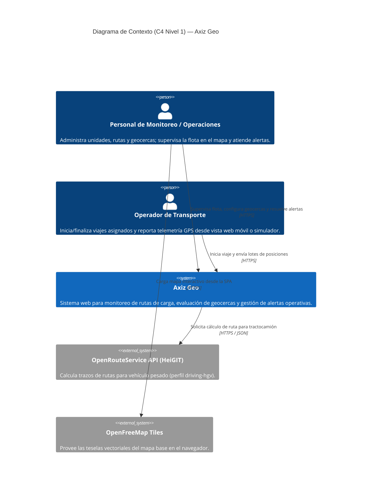
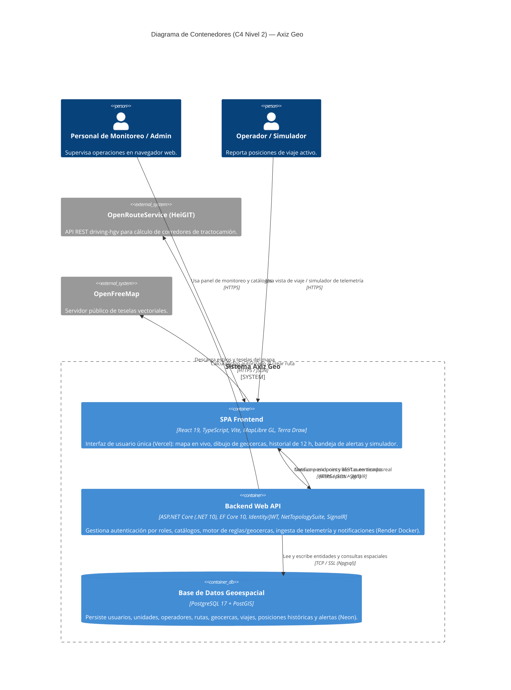

# Diagramas de Arquitectura C4 — Axiz Geo

De acuerdo con los requisitos de arquitectura del proyecto final, se presentan los diagramas **C4 de Contexto (Nivel 1)** y **C4 de Contenedores (Nivel 2)**.

---

## Nivel 1 — Diagrama de Contexto del Sistema

Muestra quiénes utilizan **Axiz Geo** y con qué sistemas externos interactúa.

---

## Nivel 2 — Diagrama de Contenedores

Detalla cómo se relacionan el **Frontend (SPA React 19 + TypeScript)**, el **Backend (ASP.NET Core Web API .NET 10)**, la **Base de Datos (PostgreSQL + PostGIS)** y los servicios externos.

