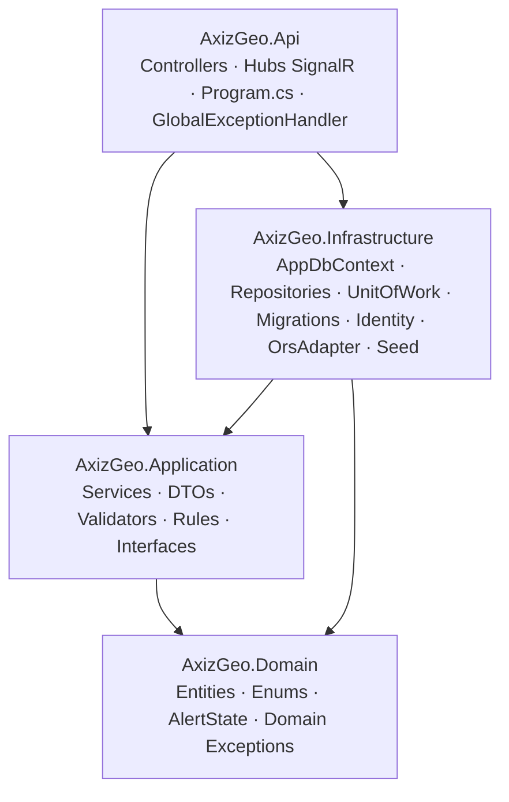
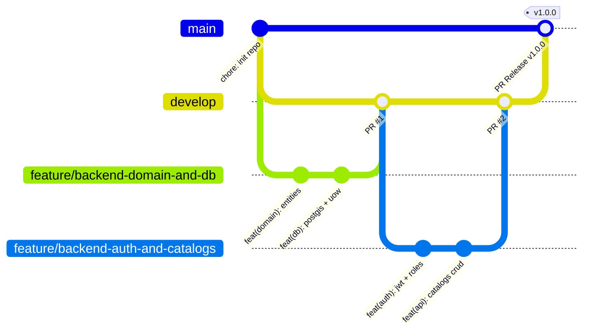
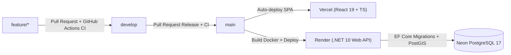

# Axiz Geo — Patrones de Diseño, ORM y Estrategia Git / CI-CD

Documento técnico de referencia para la implementación y exposición de **arquitectura, elección de ORM, patrones de diseño aplicados y flujo de integración continua**.

---

## 1. Elección de ORM: Entity Framework Core 10 vs. Dapper

| Criterio | **EF Core 10** (Elegido) | **Dapper** |
|---|---|---|
| Velocidad de desarrollo | ✅ Alta: mapeo fuertemente tipado y LINQ | ⚠️ Requiere escribir todo el SQL manualmente |
| Migraciones de esquema | ✅ Integradas (`dotnet ef migrations`) | ❌ Requiere herramientas adicionales |
| ASP.NET Core Identity | ✅ Soporte oficial directo | ❌ Requiere proveedores externos o mantener EF aparte |
| PostGIS / tipos espaciales | ✅ `UseNetTopologySuite()` traduce `Point`, `Polygon` y `LineString` directamente a `geography` e índices `GIST` | ⚠️ Requiere *type handlers* manuales |
| Unit of Work | ✅ Integrado transaccionalmente en `DbContext` | Manual sobre `IDbTransaction` |
| Consultas SQL específicas | ✅ Permite `Database.SqlQuery<T>()` cuando se requiere SQL nativo | ✅ Su fortaleza principal |

### Justificación técnica de Repository sobre EF Core
Aunque `DbContext` y `DbSet<T>` actúan internamente como Unit of Work y repositorio de bajo nivel, nuestra capa `AxizGeo.Application` define contratos de dominio (`IUnitOfWork`, `ITripRepository`, `IPositionRepository`, `IAlertRepository`) implementados en `AxizGeo.Infrastructure` para:
1. **Encapsular consultas de negocio** (ej. `GetActiveWithoutSignalSinceAsync`, `GetLastValidByTripAsync`, `HasOpenAlertAsync`) en un solo lugar reutilizable.
2. **Mantener `Application` desacoplada de EF Core y Npgsql**, facilitando pruebas unitarias rápidas sin base de datos física.
3. Permitir optimizar consultas puntuales con SQL nativo de PostGIS sin alterar los servicios de negocio.

---

## 2. Arquitectura en Capas del Backend

- **`AxizGeo.Domain`**: Entidades, enumeraciones e invariantes puras sin dependencias de infraestructura.
- **`AxizGeo.Application`**: Casos de uso, DTOs, validadores (`FluentValidation`), estrategias de geocercas, cadena de reglas y puertos (`interfaces`).
- **`AxizGeo.Infrastructure`**: Implementación de persistencia PostgreSQL/PostGIS, Identity/JWT y adaptadores HTTP externos.
- **`AxizGeo.Api`**: Controladores REST, autorización por roles, SignalR, manejo global de errores RFC 9457 (`ProblemDetails`) e inyección de dependencias.

---

## 3. Catálogo de Patrones de Diseño Aplicados

| Patrón | Ubicación en el código | Problema concreto que resuelve |
|---|---|---|
| **Repository** | `IRepository<T>`, `Repository<T>`, `TripRepository`, `PositionRepository`, `AlertRepository` | Aísla el acceso a datos de la lógica de aplicación y centraliza consultas espaciales y operativas. |
| **Unit of Work** | `IUnitOfWork`, `UnitOfWork` | Garantiza que guardar posiciones, actualizar `LastPositionAt` del viaje y crear alertas ocurra en **una sola transacción atómica**. |
| **State** | `AlertState` (`NewAlertState`, `InReviewAlertState`, `ResolvedAlertState`, `DismissedAlertState`) | Controla las transiciones válidas del ciclo de vida de una alerta e impide transiciones ilegales (ej. reabrir una alerta resuelta) sin condicionales dispersos. |
| **Strategy** | `IGeofenceEvaluator` (`CircleGeofenceEvaluator`, `PolygonGeofenceEvaluator`, `CorridorEvaluator`) | Evalúa distintos tipos geométricos de geocercas y corredores de forma intercambiable sin bloques `switch`/`if` acoplados. |
| **Chain of Responsibility** | `ITelemetryRule` (`AccuracyRule` → `DeviationRule` → `RestrictedZoneRule`) y `TelemetryPipeline` | Procesa cada posición GPS a través de eslabones independientes; si una lectura tiene baja precisión (`> 50 m`), corta la cadena sin disparar falsas alarmas. |
| **Adapter** | `IRoutingProvider` → `OpenRouteServiceAdapter` | Traduce peticiones y respuestas externas de HeiGIT OpenRouteService (`driving-hgv`) a geometrías `LineString` internas del dominio, ocultando el proveedor externo. |
| **Factory** | `AlertFactory` | Centraliza la creación consistente de alertas asignando severidad, mensaje en español y metadatos según el `AlertType`. |
| **Observer (Pub/Sub)** | `IAlertNotificationChannel` → `SignalRAlertChannel` (`FleetHub`) + `EmailAlertChannel` (SMTP) | Desacopla el motor de telemetría/alertas de los medios de salida; al generarse una alerta notifica tanto en tiempo real al panel web como por correo electrónico sin tocar las reglas de negocio. |
| **DTO** | Registros `*Dto`, `*Request`, `*Response` en `AxizGeo.Application/DTOs` | Evita exponer entidades internas o datos sensibles de Identity y define un contrato estable hacia el Frontend. |
| **Dependency Injection** | `DependencyInjection.cs` (`Application`, `Infrastructure`) y `Program.cs` | Inversión de control entre capas para bajo acoplamiento y pruebas unitarias aisladas. |

---

## 4. Estrategia de Ramas, Commits e Integración Continua (CI/CD)

### 4.1 Modelo de ramificación (Gitflow simplificado)

- **`main`**: Rama estable de producción conectada al despliegue en **Vercel** y **Render**.
- **`develop`**: Rama de integración continua donde convergen Frontend y Backend mediante Pull Requests.
- **`feature/*`** y **`fix/*`**: Ramas de trabajo por funcionalidad o corrección, fusionadas hacia `develop` previa validación de GitHub Actions.

### 4.2 Convención de mensajes de commit (Conventional Commits)
Formato: `<tipo>(<ámbito>): <descripción breve>`
- `feat`: nueva funcionalidad (`feat(auth): ...`, `feat(geofence): ...`, `feat(ui): ...`)
- `fix`: corrección de defecto
- `test`: pruebas automatizadas
- `docs`: documentación, diagramas C4 y bitácora
- `ci` / `chore`: pipelines de integración, Docker y configuración

### 4.3 Pipeline de Integración y Despliegue Continuo

Cada Pull Request hacia `develop` o `main` ejecuta `.github/workflows/ci.yml`:
1. **`Backend (.NET 10)`**: `dotnet restore` → `dotnet build -c Release` → `dotnet test -c Release`.
2. **`Frontend (React 19 + TS)`**: `npm ci` → `npx tsc -b` → `npm run lint` → `npm run build`.
