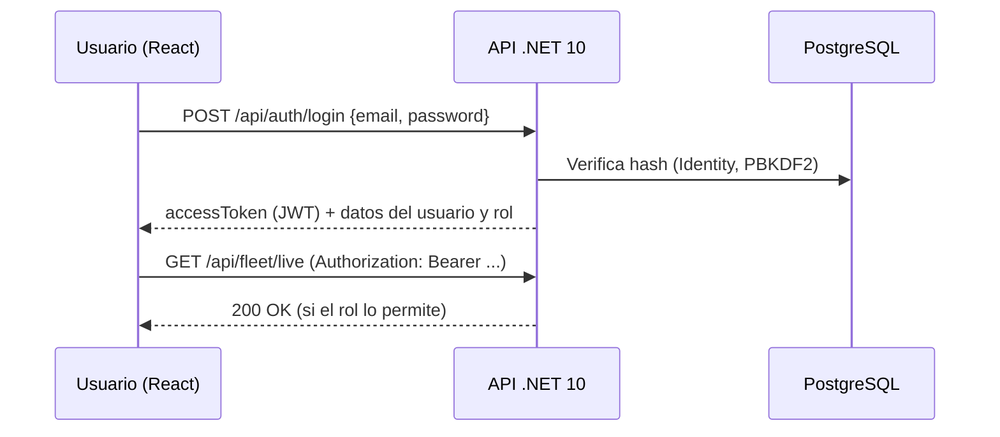
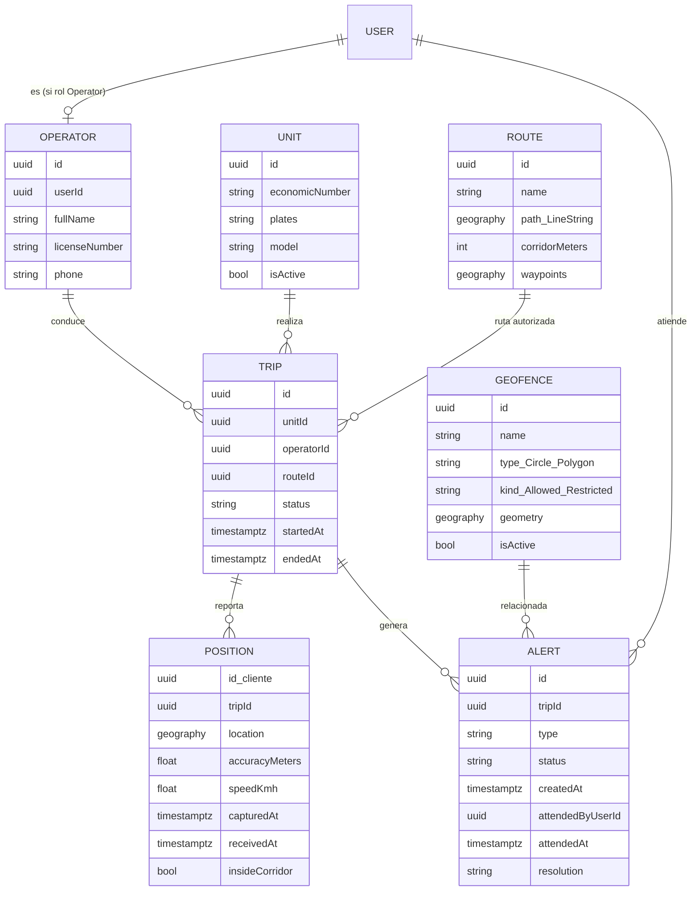
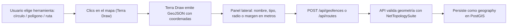
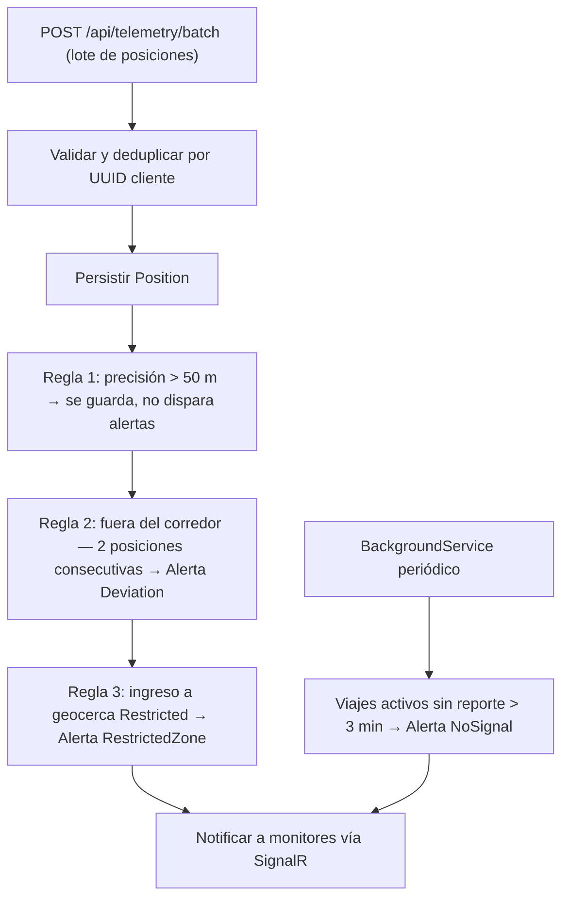

# Axiz Geo — Stack Tecnológico y Análisis Técnico

> [!IMPORTANT]
> Documento de arquitectura, decisiones de stack y alcance priorizado (**MUST** vs **NICE**) alineado a los requisitos técnicos del proyecto y al flujo principal de demostración: recorrido normal → desvío → alerta → atención.

---

## 1. Resumen de decisiones

| Tema | Decisión | Por qué, en una línea |
|---|---|---|
| Frontend | **React 19 + TypeScript + Vite** | Requisito técnico de SPA moderna tipada. |
| Backend | **ASP.NET Core Web API (.NET 10)** | Requisito técnico para lógica de negocio y acceso a datos. |
| Base de datos | **PostgreSQL + PostGIS** (no NoSQL) | Datos relacionales e índices/consultas geoespaciales nativas. Ver §3. |
| Login | **ASP.NET Core Identity + JWT + roles** | Todo integrado en la API sin depender de terceros. Ver §2. |
| Mapa | **MapLibre GL JS** + tiles de **OpenFreeMap** | Open source, gratuito, sin API key ni tarjeta. |
| Dibujo de geocercas | **Terra Draw** | Clic en el mapa → coordenadas GeoJSON listas para persistir. Ver §4. |
| Ruteo de tractocamión | **openrouteservice `driving-hgv`** (`api.heigit.org/openrouteservice`), desde el backend | Perfil de camión pesado gratuito; la API key queda protegida en servidor. |
| Geometría en backend | **NetTopologySuite** + PostGIS | Evaluación de puntos en polígonos y distancia en metros a corredores. |
| Tiempo real | **SignalR** | Actualización automática del mapa y alertas al instante. |
| Hosting | Front: **Vercel** · API: **Render (Docker)** · BD: **Neon** | Planes gratuitos compatibles con SPA, .NET 10 y PostGIS. |
| CI | **GitHub Actions** | Compilación y pruebas de frontend y backend en `develop` y `main`. |

---

## 2. Seguridad e inicio de sesión

### 2.1 Enfoque recomendado
**ASP.NET Core Identity** (usuarios, hash de contraseñas, bloqueo por intentos) **+ JWT Bearer + autorización por roles**.

### 2.2 Roles y permisos

| Rol | Puede |
|---|---|
| **Admin** | Todo: usuarios, catálogos, rutas, geocercas, viajes, monitoreo, alertas y simulador. |
| **Monitor** | Ver el mapa, historial y alertas; atender alertas; gestionar rutas, geocercas y viajes. |
| **Operator** | Solo **su** viaje activo: iniciar/finalizar y enviar posiciones. No consulta otras unidades. |

En .NET se aplica con `[Authorize(Roles = "...")]`. El operador solo envía posiciones de **su** viaje validando que el `tripId` pertenezca al `operatorId` del token.

### 2.3 Lista de seguridad

| Tema | Cómo | Prioridad |
|---|---|---|
| Hash de contraseñas | Identity (PBKDF2 de serie) | MUST |
| JWT firmado | `Microsoft.AspNetCore.Authentication.JwtBearer`; clave secreta en variable de entorno | MUST |
| Roles | `Admin` / `Monitor` / `Operator`; usuarios de demo creados por *seed* | MUST |
| CORS | Permitir solo el dominio de Vercel y `localhost:5173` | MUST |
| Secretos fuera del repo | `dotnet user-secrets` en local; variables de entorno en Render y Vercel; `.env` en `.gitignore` | MUST |
| HTTPS | Provisto por Vercel y Render | MUST |
| Validar entradas | FluentValidation: coordenadas válidas, polígonos cerrados, dimensiones, fechas | MUST |
| Límite de intentos en login | `AddRateLimiter` + *lockout* de Identity | MUST |
| Auth para SignalR | El JWT viaja en `?access_token=` únicamente en `/hubs/fleet` | MUST |

---

## 3. Base de datos: ¿SQL o NoSQL?

**Decisión: PostgreSQL + PostGIS.**

| Criterio | PostgreSQL + PostGIS | MongoDB |
|---|---|---|
| Datos relacionales (usuario → operador → viaje → unidad → alertas) | ✅ Llaves foráneas e integridad | ⚠️ Referencias manuales, sin JOIN relacional |
| ASP.NET Core Identity | ✅ Proveedor oficial de EF Core | ⚠️ Proveedores de comunidad |
| Punto dentro de polígono | ✅ `ST_Contains`, `ST_Within` | ✅ `$geoWithin` |
| Distancia a una línea (corredor de ruta) | ✅ `ST_DWithin`, `ST_Distance` sobre `geography` (en metros) | ⚠️ Limitado; requiere cálculo manual |
| Buffer de ruta (corredor de X metros) | ✅ `ST_Buffer` | ❌ No existe |
| Línea de historial y simplificación | ✅ `ST_MakeLine`, `ST_Simplify` | ⚠️ En código |
| Integración con .NET | ✅ `Npgsql.EntityFrameworkCore.PostgreSQL.NetTopologySuite` | ⚠️ Sin soporte EF Core espacial maduro |
| Hosting gratuito | Neon / Supabase (ambos con PostGIS) | MongoDB Atlas M0 |

### 3.1 Modelo de datos

**Reglas técnicas clave:**
- Coordenadas en **SRID 4326** (WGS84), orden GeoJSON **`[longitud, latitud]`** (ej. Nuevo Laredo: `[-99.5075, 27.4763]`).
- Cada posición conserva **`capturedAt`** y **`receivedAt`** para distinguir telemetría en tiempo real de lotes sincronizados tras desconexión.
- El **`id` de la posición lo genera el cliente** (UUID) para garantizar idempotencia.
- Todas las marcas de tiempo se persisten en **UTC** (`timestamptz`) y se formatean en `America/Matamoros` en la UI.

---

## 4. Geocercas: creación interactiva con clics en el mapa

### 4.1 Tipos de geocerca y rutas

| Elemento | Cómo se dibuja | Cómo se guarda | Uso típico |
|---|---|---|---|
| **Círculo** | Clic en el centro y arrastrar el radio | `Point` + `radiusMeters` | Bodega, aduana, patio |
| **Polígono** | Clic en cada vértice; doble clic cierra | `Polygon` | Parque industrial, zona restringida |
| **Corredor de ruta** | Clic en origen, puntos intermedios y destino → `POST /api/routes/preview` calcula ruta HGV → vista previa con margen en metros | `LineString` + `corridorMeters` | Ruta autorizada del viaje |

### 4.2 Flujo técnico

---

## 5. Monitoreo en vivo de múltiples unidades

| Funcionalidad | Implementación | Prioridad |
|---|---|---|
| Última posición de toda la flota | `GET /api/fleet/live` | MUST |
| Marcador por camión con ícono + color de estado | En ruta · Detenido · Desviado · Sin señal (>3 min) · Sin viaje | MUST |
| Antigüedad del reporte | "Hace 45 s" / "Hace 6 min" (no presentar posiciones antiguas como actuales) | MUST |
| Actualización automática | **SignalR** (`/hubs/fleet`) con respaldo de *polling* cada 10 s | MUST |
| Lista lateral de unidades | Selección para centrar mapa y abrir detalle | MUST |

---

## 6. Historial de recorrido por periodos (ej. 12 horas)

- **Endpoint:** `GET /api/units/{unitId}/track?from=...&to=...` (por defecto últimas 12 horas).
- **Respuesta:** `LineString` del recorrido, puntos con velocidad/precisión/hora, viajes asociados y eventos del periodo (inicio, fin, alertas).
- **Visualización:** Selector rápido (1 h, 6 h, **12 h**, 24 h) mostrando el corredor autorizado semitransparente debajo y el trazo real encima para evidenciar desviaciones.

---

## 7. Motor de reglas y alertas (Backend)

---

## 8. Simulador de telemetría

Pantalla `/simulador` en la SPA para pruebas controladas y demostración:
1. Selecciona un viaje activo y carga su ruta autorizada.
2. Interpola coordenadas sobre el corredor con `@turf/turf`.
3. Permite accionar los 3 escenarios clave:
   - **Recorrido normal** sobre la ruta.
   - **Desviación** fuera del corredor autorizado (disparando alerta tras 2 reportes consecutivos).
   - **Pérdida y recuperación de señal** (encolando posiciones localmente con su `capturedAt` original y enviándolas en lote al reconectar).

---

## 9. Stack detallado por capa

### 9.1 Frontend
- `vite` + `react@19` + `typescript`
- `react-router` (modo SPA)
- `@tanstack/react-query` + `zustand`
- `react-hook-form` + `zod`
- `maplibre-gl` + tiles **OpenFreeMap** (`https://tiles.openfreemap.org/styles/liberty`)
- `terra-draw` + `@turf/turf`
- `@microsoft/signalr`
- `date-fns` / formateo en zona `America/Matamoros`

### 9.2 Backend
- **ASP.NET Core Web API (.NET 10)** con arquitectura limpia en 4 capas + proyecto de pruebas `xUnit`
- `Microsoft.AspNetCore.Identity.EntityFrameworkCore` + `Microsoft.AspNetCore.Authentication.JwtBearer`
- `Npgsql.EntityFrameworkCore.PostgreSQL` + `Npgsql.EntityFrameworkCore.PostgreSQL.NetTopologySuite`
- `NetTopologySuite` + `NetTopologySuite.IO.GeoJSON4STJ`
- `FluentValidation`
- `Microsoft.AspNetCore.SignalR`
- `HealthChecks` (`/health`) y `ProblemDetails`

---

## 10. Consideraciones operativas y limitaciones declaradas

- **Privacidad:** El monitoreo aplica únicamente durante viajes activos y utiliza datos ficticios en el entorno académico.
- **Limitaciones del alcance:** Una alerta de desviación requiere verificación humana y no constituye prueba de robo; los datos de restricciones para vehículos pesados en OpenStreetMap pueden ser parciales según el tramo carretero.
- **Arranque en frío en capa gratuita:** Render suspende contenedores gratuitos tras 15 minutos de inactividad y Neon suspende cómputo tras 5 minutos; antes de una demostración en vivo debe consultarse `/health` para reactivar ambos servicios.
